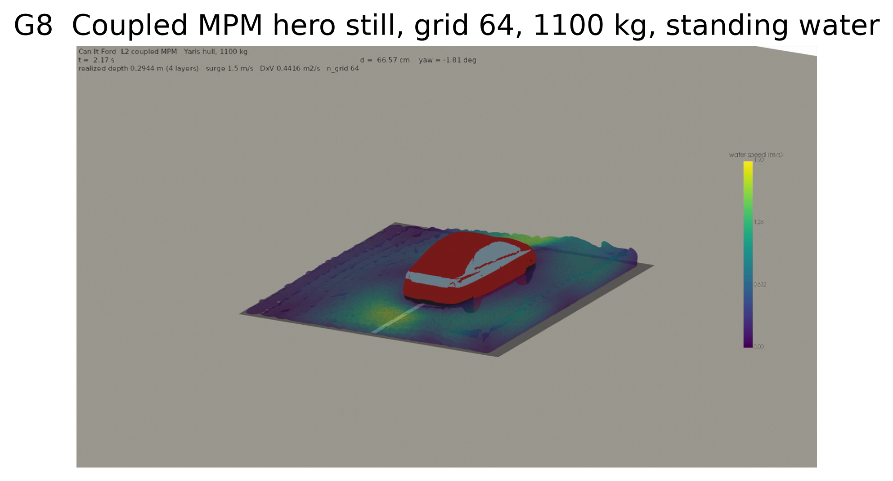

# Josephine Cerrell

Integrated Sciences student at Claremont McKenna College (class of 2029).

**Summer 2026:** NSF REU student at the Texas Advanced Computing Center (TACC), UT Austin, in
Dr. Krishna Kumar's GeoElements Lab.

---

## Project: Can It Ford?

*Simulated water around a Toyota Yaris, colored by speed. This is from one of the first runs, whose
results I later withdrew because they measured the start of the flow instead of a steady current.*

Can a car safely drive through a flooded road? I compared three ways of answering: a simple
water-depth rule, the Australian flood guideline for vehicles (AR&R), and a GPU simulation of
water flowing around a 2010 Toyota Yaris.

- Found that using the full AR&R guideline, instead of the depth x speed shortcut people often
  use, changes 23 of 70 flood cases from safe to unsafe.
- Ran the simulations on TACC's Lonestar6 and Vista supercomputers. My first 17 runs turned out to
  be measuring the start of the flow instead of a steady current, so I set those results aside and
  started a new set of 46 runs. That set doesn't have a final answer yet.
- Recorded, for every run, which settings the run itself saved and which were filled in later, and
  wrote checks that run automatically on every push against copies of the first 17 runs' records.
- Made a 3D model of a real drainage crossing from video using Gaussian splatting.
- In my fork of the lab's simulation engine, added particle seeding from watertight car meshes and
  fixed a bug, still present upstream, that broke loading of mesh `.ply` files:
  [jcerrell-IS/mpm-engine](https://github.com/jcerrell-IS/mpm-engine). Not merged upstream.

[Paper](https://github.com/jcerrell-IS/can-it-ford/blob/main/public_release/Cerrell_CanItFord_paper.pdf) ·
[Code](https://github.com/jcerrell-IS/can-it-ford) ·
[Live demo](https://huggingface.co/spaces/josiecerrell/can-it-ford) ·
[Simulation records](https://huggingface.co/datasets/josiecerrell/can-it-ford-steady-force) ·
[Scenario data](https://huggingface.co/datasets/josiecerrell/can-it-ford-scenario-sweep)

## Tools

Python, NumPy, matplotlib, NVIDIA Warp, gsplat, Slurm, Linux, Git, GitHub Actions, Gradio,
Hugging Face

## Contact

[LinkedIn](https://www.linkedin.com/in/josephinecerrell) ·
[Hugging Face](https://huggingface.co/josiecerrell) ·
jcerrell29@students.claremontmckenna.edu
